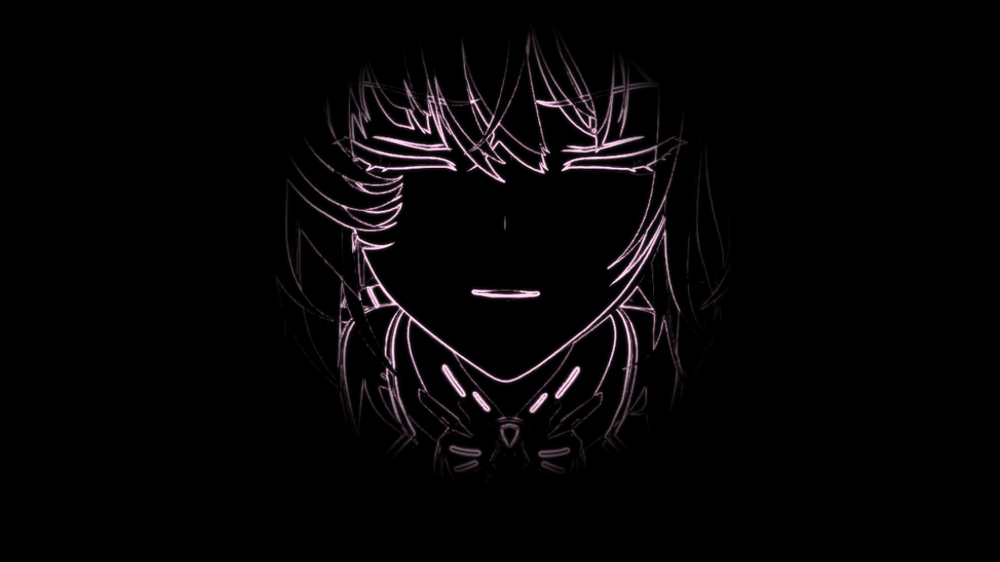
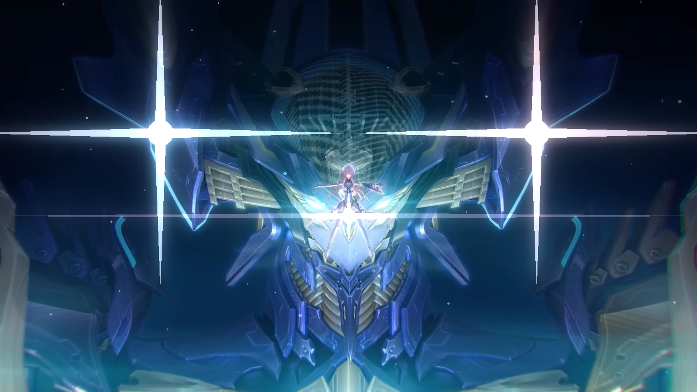
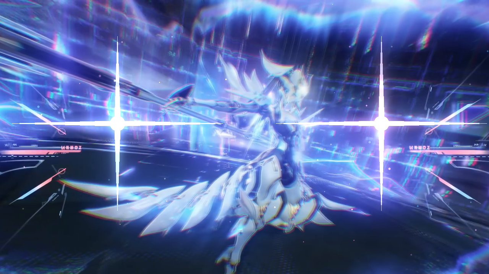
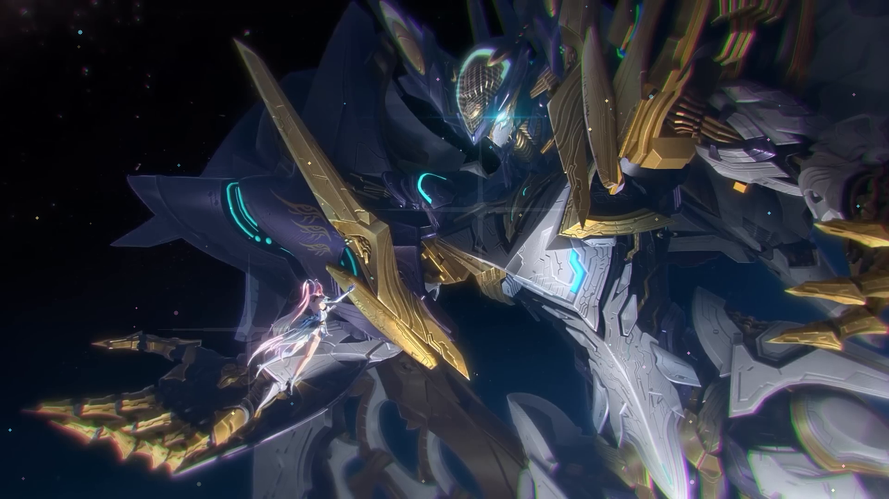
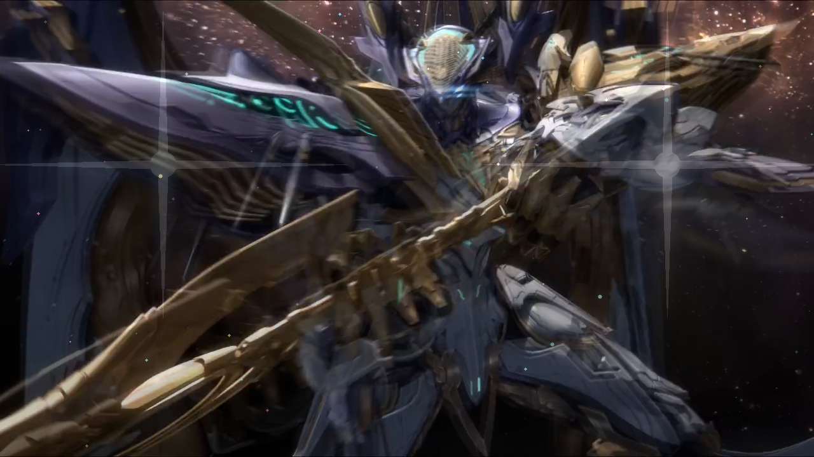
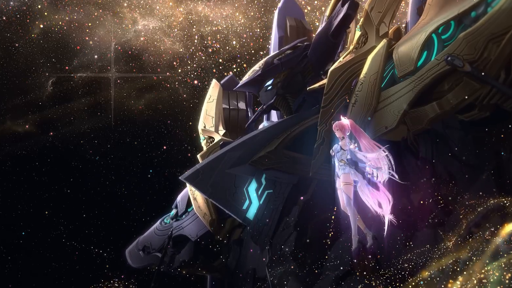
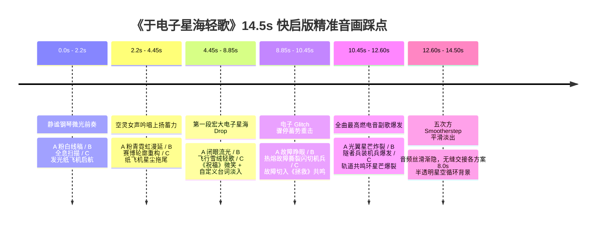

# Aemeath AI Boot Animation ✦ 爱弥斯开场动画（全主流 AI 桌面端支持）

[](./LICENSE)
[](#快速开始)
[](#快速开始)

一个同时支持 **Google Antigravity / DeepSeek Harness / Claude Desktop / Codex (ChatGPT)** 四大主流 AI 桌面端的《鸣潮》**爱弥斯（Aemeath · 飞行雪绒）** 主题开场动画与半透明动态星海背景项目。

项目参考 [Roxy-Antigravity-Boot-Animation](https://github.com/xxjj2024/Roxy-Antigravity-Boot-Animation) 与 [wynneceles/ai-boot-animations](https://github.com/wynneceles/ai-boot-animations) 的零入侵双形态架构，采用 100% 库洛官方原片素材 +《于电子星海轻歌》**14.5 秒快启高能版**，支持 **四大主流 AI 桌面端同时独立监听并发播放**、**A / B / C 三套演出方案一键切换**、以及 **实时自定义思源宋体台词字幕**（默认台词：`拯救世界的事，就交给我吧……`），**全程不修改任何软件本体文件**。

### 支持的桌面客户端（单托盘同时监听，可分别勾选开关）
- **Google Antigravity**（`Antigravity.exe` + 官方左侧 Plugins 栏内置 MCP App 插件）
- **DeepSeek Harness**（`DeepSeek Harness.exe` / `dsh-desktop`）
- **Claude Desktop**（`claude.exe`，自动过滤非主窗口小窗）
- **OpenAI Codex / ChatGPT Desktop**（`Codex.exe` / `ChatGPT.exe`）

---

## 三套官方原片演出方案预览（100% 库洛官方原素材，可随时一键切换）

### 方案 A · 一镜到底「官方星海睁眼觉醒」
> 纯黑星穹提取自官方《拯救》闭眼特写的粉白荧光线稿 → 赛博粉青霓虹扫描 → 官方《纸飞机》闭眼微笑与青翼流光 → `9.0s` 电子幽灵故障闪烁 + 官方《拯救》同机位金色星星眼睁开 → `10.5s` 官方深空纯白星辉光翼爆发 → 无缝星穹呼吸循环。

| 1.6s 官方原画荧光线稿浮现 | 9.9s 官方《拯救》同机位星星眼睁开 | 11.1s 官方深空纯白光翼觉醒爆发 |
| :---: | :---: | :---: |
|  |  |  |

### 方案 B · 双形态切换「官方实机：电子幽灵 × 隧者机兵」
> 官方《战斗演示》赛博全息扫描重构 → `4.5s` 数字矩阵现身 &《祝福》舞台飞行雪绒轻歌 → `8.85–10.45s` 热熔 Glitch 故障撕裂 + 粉色像素爱心聚能闪切 → `10.5s` **官方实机「隧者兵装 · 机兵形态」** 展翼冲锋与四角星芒核爆 → 深空隧者机兵无缝循环。

| 7.4s 飞行雪绒 · 官方舞台轻歌 | 10.9s 隧者兵装 · 官方实机机兵展翼 | 13.5s 深空隧者无缝待机循环 |
| :---: | :---: | :---: |
|  |  |  |

### 方案 C · 多幕官方剧情混剪「纸飞机 / 祝福 / 拯救 / 远航星」
> 官方 EP《纸飞机》掠过晴空雪原 → `4.5s` 官方 PV《祝福》舞台泪光轻唱与破防微笑 → `8.85s` 故障撕裂切入官方短片《拯救》电弧共鸣 + 隧者巨剑横贯星海 → `12.5s` 温柔溶解入深空星尘守望循环。

| 2.4s 官方 EP《纸飞机》启航 | 11.7s 官方短片《拯救》隧者巨剑爆发 | 13.6s 官方深空金色星尘守望循环 |
| :---: | :---: | :---: |
|  |  |  |

---

## 14.5s 音画踩点时间轴（《于电子星海轻歌》快启版）



---

## 快速开始

### 方式零：免编译一键安装版（推荐直接分享，解压即用）

前往本仓库 **[Releases 页面](https://github.com/Fantasicrap/Aemeath-Antigravity-Boot-Animation/releases)** 下载最新 **`爱弥斯开机动画_全平台AI一键安装版_v1.2.zip`**，解压后：
- 双击 **`1_点我试玩(自动检测所有AI窗口).cmd`** 自动在当前已打开的 Antigravity / DeepSeek Harness / Claude / Codex 窗口上立即体验；
- 双击 **`2_点我安装(开机自启).cmd`** 设为每次打开四大 AI 桌面端自动播放；
- 双击 **`3_安装Antigravity侧栏插件.cmd`** 一键安装 Antigravity 侧栏插件；
- 双击 **`4_浏览器直接预览动画.html`** 可直接在浏览器里预览 A/B/C 三套方案。

### 方式一：Windows 桌面托盘源码版（零 SDK 直编）

系统要求：**Windows 10 / 11**（无需安装 Python、Node.js 或 .NET SDK，使用系统自带 `csc.exe` 2 秒直编）。

1. 进入 `windows-overlay/` 目录：
   - **仅本次试运行（不写开机自启）**：双击 **`仅本次试运行.cmd`**，立即编译并弹出设置窗口，同时在 Antigravity 窗口上播放开场动画。
   - **安装为日常开机自启**：双击 **`安装开机自启.cmd`**，自动安装到剩余空间最大的非系统盘并注册开机自启。
2. **随时切换 A / B / C 方案与自定义台词**：
   - 左键或右键点击系统托盘的粉青四芒星 **`✦`** 图标 → 直接勾选切换 **方案 A / 方案 B / 方案 C**；
   - 点击 **「设置与自定义台词…」**，可即时修改主台词（默认：`拯救世界的事，就交给我吧……`）与副台词（留空则仅显示主台词）、背景不透明度（0%–80%）与开屏音量，**修改实时生效，无需重新渲染 MP4**。
3. **一键卸载**：右键托盘 **`✦`** →「卸载爱弥斯开机动画…」，或运行 `uninstall.ps1`。

### 方式二：Antigravity 内置侧栏插件（「爱弥斯开场」）

系统要求：已安装 Python 3（运行零依赖 `server.py`）。

在项目根目录执行：

```powershell
powershell -NoProfile -ExecutionPolicy Bypass -File .\antigravity-plugin\install-plugin.ps1
```

安装后在 Antigravity 左侧 **Plugins** 栏点击 **「爱弥斯开场」** 即可随时播放：
- 悬停右下角或动画结束后，可直接点击 **`A 星海觉醒` / `B 隧者机兵` / `C 远航星忆`** 切换方案（偏好通过 MCP App 持久化保存在插件数据目录中）；
- 点击 **`✎ 台词`** 随时修改自定义台词与开关字幕；
- 支持快捷键 `1 / 2 / 3` 切换方案、`R` 重播、`ESC / 空格` 跳过。

---

## 目录结构

```text
Aemeath-Antigravity-Boot-Animation/
├── README.md
├── LICENSE                                  # GNU GPL v3
├── docs/preview/                            # 三套方案实拍渲染预览图
├── windows-overlay/                         # 模块一：Windows 桌面托盘叠加层（支持 A/B/C 切换与动态自定义台词）
│   ├── src/
│   │   ├── AemeathAntigravityBoot.cs        # WPF 浮层主程序（PerMonitorV2 + 点击穿透 + 思源宋体动态字幕）
│   │   └── app.manifest
│   ├── assets/
│   │   ├── a/ (intro.mp4, loop.mp4, loop-x2.mp4)
│   │   ├── b/ (intro.mp4, loop.mp4, loop-x2.mp4)
│   │   └── c/ (intro.mp4, loop.mp4, loop-x2.mp4)
│   ├── build.ps1 / install.ps1 / uninstall.ps1
│   ├── 仅本次试运行.cmd
│   └── 安装开机自启.cmd
├── antigravity-plugin/                      # 模块二：Antigravity 官方 MCP App 侧栏插件
│   ├── plugin.json / mcp_config.json / server.py
│   ├── intro.html                           # 预打包单文件（内联 A/B/C 三模式 WebP + 14.5s MP3 + 官方 MCP SDK）
│   ├── assets/logo.svg
│   ├── assets_src/                          # 13 张 WebP 图层 + aemeath_boot_14s5.mp3
│   ├── src/                                 # 前端源码（HTML / Canvas FX / Glitch / SFX / Director / Bridge）
│   ├── build.py                             # 零 Node 依赖单文件打包脚本
│   └── install-plugin.ps1
└── tools/                                   # 模块三：离线内容重渲染工具链
    ├── source_audio/                        # 原始 22.3s MP3 & 14.5s 平滑淡出快启 WAV
    ├── keyframes/                           # 9 张高一致性 16:9 爱弥斯关键帧原画
    └── render_aemeath_boot.py               # OpenCV 流体发丝 + Glitch 故障 + 星芒粒子 + Baseline MP4 渲染脚本
```

---

## 致谢与声明

- Windows 外置点击穿透浮层、重叠交接循环与多屏 DPI 校位架构致敬并基于 **[wynneceles/ai-boot-animations](https://github.com/wynneceles/ai-boot-animations)** 与 **[xxjj2024/Roxy-Antigravity-Boot-Animation](https://github.com/xxjj2024/Roxy-Antigravity-Boot-Animation)**（GPL-3.0）。
- 角色「爱弥斯（Aemeath / 飞行雪绒）」及相关设定、配乐《于电子星海轻歌》源自库洛游戏《鸣潮》（Wuthering Waves），本项目仅供个人学习、桌面美化与同人交流，严禁用于任何商业用途。
